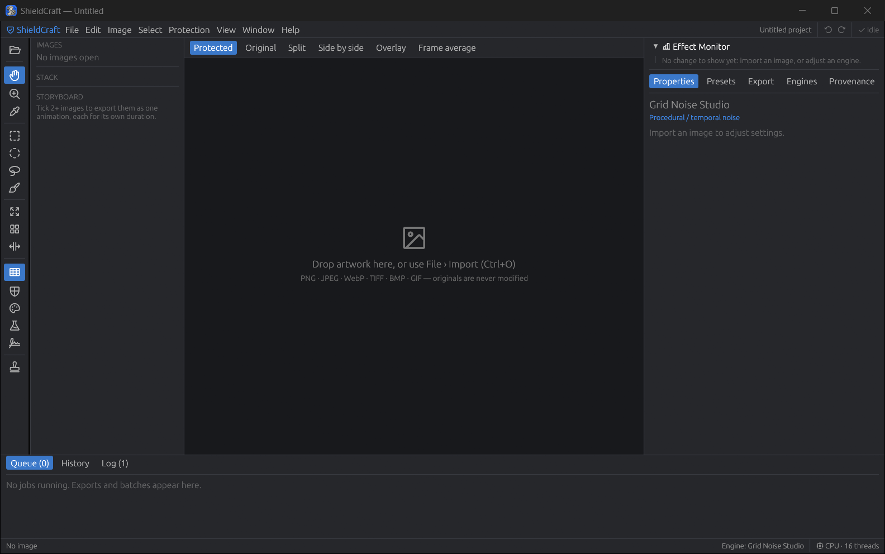

# ShieldCraft

A local, private artwork-protection workstation for Windows, written in Rust. Open source under
**MIT OR Apache-2.0**.

- **Grid Noise Studio** (flagship): animated grid-noise protection. Viewers see your artwork, while any
  single frame or screenshot is scrambled. Based on techniques by **stelmosfire13-alt**
  ([Grid Noise Animator](https://github.com/stelmosfire13-alt/Grid-Noise-Animator)), independently
  implemented.
- **Hope:RE Noise, Style Cloak (Glaze mode) and Concept Poison (Nightshade mode)**: adversarial
  perturbations using a Rust port of [Hope:RE](https://github.com/HopeArtOrg/hope-re) by HopeArtOrg
  (MIT). They run in a crash-isolated worker, with a live strength preview and auto-iterate, and
  every run reports whether it actually improved the target model's loss.
- **Signature Ink**: an invisible authorship signature you can verify later.
- **Provenance (Lantern)**: optional lookups in the [Lantern](https://lantern-us.com) public
  provenance registry. These are off by default and only run when you click.
- **Optional selection tools**: rectangle, ellipse, lasso and brush (Shift adds, Alt subtracts,
  Ctrl+Shift+I inverts) let you protect only part of an image. With no selection, the whole image is
  protected. F1 lists all keyboard shortcuts.
- Effect Monitor, Difference view, batch processing, presets, projects, processing reports, and a
  Third-Party Licenses & Credits window.

Processing runs on your computer. Nothing is uploaded unless you explicitly use a Lantern image
check. There are no accounts and no telemetry. No protection method can guarantee that artwork will
not be used for AI training, copied or imitated. ShieldCraft is not affiliated with the University
of Chicago (Glaze, Nightshade), HopeArtOrg or Lantern.

## Download

Get the latest version from the [Releases page](https://github.com/VibeCodedSoftware/ShieldCraft/releases/latest):

| File | What it is |
|---|---|
| `ShieldCraft-1.0.0-setup.exe` | **Recommended.** Installs for your Windows account (no administrator rights), adds Start menu and desktop shortcuts, and can be removed from *Settings › Apps*. |
| `ShieldCraft-1.0.0-windows-x64.zip` | Portable. Unzip anywhere and run `ShieldCraft.exe`. |

Windows 10 or 11, 64-bit. The program isn't code-signed yet, so Windows SmartScreen may warn the first
time: choose **More info › Run anyway**.

## Documentation

| Document | Contents |
|---|---|
| [docs/01-REPOSITORY-AUDIT.md](docs/01-REPOSITORY-AUDIT.md) | Audit of the seven source repositories and their licenses |
| [docs/02-ARCHITECTURE.md](docs/02-ARCHITECTURE.md) | How the app, engines and Hope:RE worker fit together |
| [docs/03-STATUS.md](docs/03-STATUS.md) | What works, test record, known limitations |
| [docs/04-BUILD.md](docs/04-BUILD.md) | Building, packaging, smoke tests, icon |
| [PUBLISHING.md](PUBLISHING.md) | Publication checklist and open items |
| [NOTICE](NOTICE), [THIRD_PARTY_NOTICES.md](THIRD_PARTY_NOTICES.md) | Credits and licenses |
| [LICENSE-MIT](LICENSE-MIT), [LICENSE-APACHE](LICENSE-APACHE) | ShieldCraft's license |
